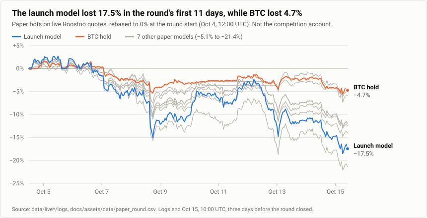
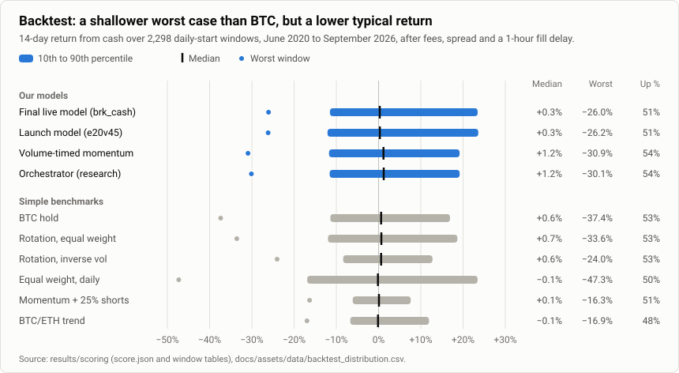
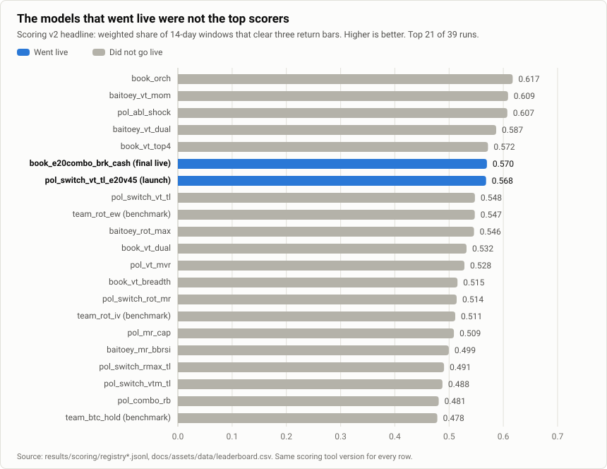
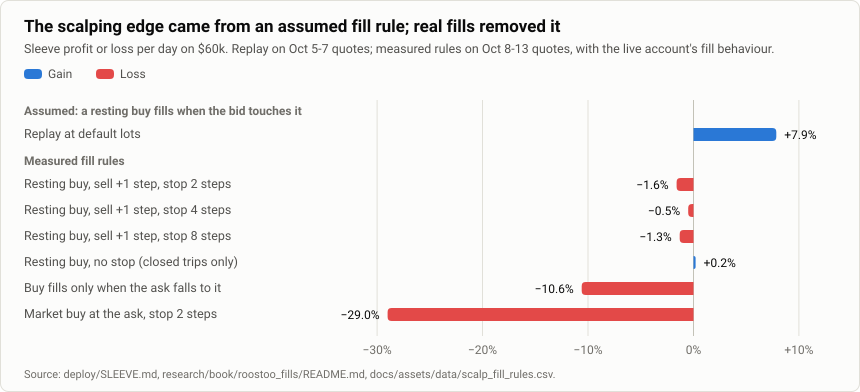
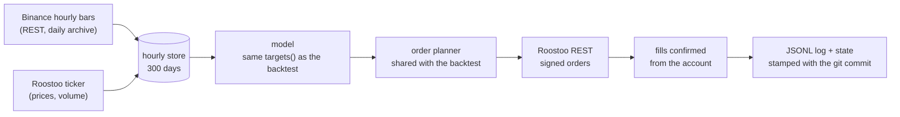

# MiniMax

**An autonomous crypto trading bot and its full research record, from the Roostoo APAC Quant Trading Hackathon (October 2026).**


Team MiniMax: Pol (live engine), Book (data, backtest, validation), Baitoey (strategies, risk).

The bot traded spot crypto by itself on one AWS EC2 machine for a 14-day round, starting from $100,000, with no leverage and no manual trading. This repository holds the code, the backtest and scoring system, the models we built, and an honest account of what worked and what did not.

> Research and competition code only, not investment advice. The round used a mock account.

**Jump to:** [Results](#results) · [What ran live](#what-ran-live) · [How models were tested](#how-models-were-tested) · [What we tried](#what-we-tried) · [Lessons](#lessons) · [Run it](#run-it) · [Layout](#repository-layout) · [Documentation](docs/README.md)

## At a glance

| | |
|---|---|
| **The round** | Oct 4 to 18, 2026, $100,000 mock account, spot only, fees 0.1% taker and 0.05% maker |
| **Launch model on paper, first 11 days** | **−17.5%**, against −4.7% for holding BTC |
| **Competition account** | About −16% on Oct 15 in our notes (team-reported). **The final return and rank are not recorded in this repo** |
| **Final live model in backtest, per 14 days** | Mean +3.7%, median +0.3%, worst −26.0%, positive in 51% of windows |
| **Research volume** | 104 models, 378 scoring runs, about 90 pre-registration and protocol documents, 385 commits |
| **Checks** | 275 automated tests; the live code replayed hour by hour before launch with 0 errors and 0 rejected orders |

## Results

### The round: the backtest's bad tail showed up

<picture>
  <source media="(prefers-color-scheme: dark)" srcset="docs/assets/charts/round_paper.dark.svg">
  
</picture>

- **Every paper bot lost more than BTC.** The best was 4-hour mean reversion at −5.1%. It had scored below the launch model in backtests, but one round cannot settle which is better.
- **The launch model landed in its backtest's bad tail.** Only 55 of 2,298 backtest windows (2%) were worse than its −17.5%, and those windows ran 14 days rather than 11.
- **These are paper bots, not the competition account.** They ran on live Roostoo quotes on the research server. The account switched models on Oct 11 and added a scalping sleeve on Oct 13 ([What ran live](#what-ran-live)). The EC2 logs are not on the research server, so the account's own curve cannot be drawn here.

### The backtest: a smaller worst case, but no better typical fortnight

<picture>
  <source media="(prefers-color-scheme: dark)" srcset="docs/assets/charts/backtest_range.dark.svg">
  
</picture>

| Per 14-day window | Final live model | Launch model | BTC hold |
|---|---:|---:|---:|
| Mean return | +3.7% | +3.7% | +1.8% |
| Median return | +0.3% | +0.3% | +0.6% |
| 10th percentile | −11.5% | −12.1% | −11.4% |
| Worst | −26.0% | −26.2% | −37.4% |
| Best | +98.6% | +98.6% | +69.2% |
| Share of windows above zero | 51% | 51% | 53% |
| Median max drawdown | 9.7% | 9.8% | 8.6% |
| Headline score (scoring v2) | 0.570 | 0.568 | 0.478 |

The higher mean comes from a long right tail, not from a typical fortnight: the median is below BTC's. By-year tables and the other strategies are in [docs/RESULTS.md](docs/RESULTS.md).

### The pick: what went live was not the top scorer

<picture>
  <source media="(prefers-color-scheme: dark)" srcset="docs/assets/charts/leaderboard.dark.svg">
  
</picture>

`book_orch` tops the table, but it was scored only on Oct 4, after launch. Against `baitoey_vt_mom`, the top model available before launch, the records show the launch model with a better risk tie-break (0.384 vs 0.368), a shallower worst window (−26.2% vs −30.9%), and +3.6% against −4.3% when last season's falling Round 1 was replayed through the live code. No note records one deciding reason.

### The scalping sleeve: an edge that came from an assumption

<picture>
  <source media="(prefers-color-scheme: dark)" srcset="docs/assets/charts/scalp_fill_rules.dark.svg">
  
</picture>

The replay assumed a resting buy fills as soon as the bid touches its price. Orders on the live account showed otherwise: a resting buy needs a trade at or below its price, and a resting sell needs the bid to reach it. Under the measured rules no version has an edge ([research/book/roostoo_fills](research/book/roostoo_fills/README.md)). The two periods differ, so read this as a change of evidence, not a like-for-like comparison.

## What ran live

| Date (2026) | What happened | Record |
|---|---|---|
| Oct 4 | Round starts with `pol_switch_vt_tl_e20v45` | `48781b8` |
| Oct 11 | Team switches to `book_e20combo_brk_cash` for more downside protection. On full history the two tie (0.609 vs 0.608 with the lock-in) | Tag `live/2026-10-11-brk-cash` |
| Oct 13 | Tick-scalping sleeve goes live beside the model. It stops itself after one test buy because of two bookkeeping bugs; no money was lost | Tag `live/2026-10-13-sleeve`, `5cfd48c` |
| Oct 14 | Sleeve fixed, $5,000 re-test prepared, Roostoo's fill rules measured on the live account. Whether the re-test reached EC2 is **UNVERIFIED** here | `deploy/HANDOFF-20261014-sleeve-retest.md` |
| Oct 15 | Notes record the account at about −16%. Decision: no new scalping or simulator strategy, keep the live system unchanged | [final_recommendation.md](research/book/gate/simulator_edge/final_recommendation.md) |
| Oct 18 | Round ends at 12:00 UTC. The last server logs stop on Oct 15 | `config.yaml` → `live.end_at` |

**The final model, in plain words.** One decision a day at 00:00 HKT.

- **BTC above its 20-day average by more than 3%:** hold the 6 coins with the strongest 7- and 14-day risk-adjusted momentum, keep a holding while it stays in the top 12, and scale the book so its estimated daily volatility stays under 4.5%.
- **Otherwise:** per-coin trend, long clear up-trends and short clear down-trends, with inverse-volatility weights and a volatility target.
- **Breakdown exit:** a long that closes below its 20-day low moves to cash until it closes back above its 20-day mean.
- **Weak-market shorts:** when BTC is below its 20-day average, its 7-day return is negative, and at most 40% of the 30 most liquid coins are up over 48 hours, short negative-momentum coins using only unused cash, capped at 25%.
- **Lock-in:** from day 10, once the account is 3% above its start, sell everything and hold cash.
- **Daily trade:** if a day has no trade by the guard hour, rebalance to target so every day stays active.

Code: [`src/models/book/_e20combo.py`](src/models/book/_e20combo.py), [`src/models/book/_cashshort.py`](src/models/book/_cashshort.py), [`src/models/pol/pol_switch_vt_tl_e20v45.py`](src/models/pol/pol_switch_vt_tl_e20v45.py). Every tunable number is in [`config.yaml`](config.yaml).



## How models were tested

- **Data:** Binance hourly bars, whose prices we checked against Roostoo's quotes.
- **Windows:** one 14-day window per day from June 2020 to September 2026, 2,298 in all, each starting from cash like the contest.
- **Costs:** 0.10% per side plus each coin's measured half-spread, with a one-hour fill delay.
- **No look-ahead:** a model sees only bars closed at decision time. An automatic check perturbs future prices and runs `targets()` with file and network access blocked.
- **Score:** how often a window's return clears three bars, weighted toward market states like the live round and toward recent periods. Risk ratios (Sortino, Sharpe, Calmar) break ties. Six hard gates must also pass. Full definition: [docs/EVALUATION.md](docs/EVALUATION.md).
- **Pre-registration:** the pass rule was usually written and committed before a run, and the failures below stay in the record.
- **Live-code replay:** the launch model ran hour by hour through the real runner and planner, with Roostoo's pair rules, spreads and fees.

### Limits of this evidence

- **Selection bias.** The top of a 104-model table is biased upward, and we did not compute a [deflated Sharpe ratio](https://papers.ssrn.com/abstract=2460551) or a probability of backtest overfitting. The scoring runs are in [reports/leaderboards](reports/leaderboards). Some research is not part of this public repository, so treat the trial count as a lower bound.
- **Overlap.** The 2,298 windows overlap heavily, which leaves about 164 independent fortnights, in one asset class.
- **The holdout was spent before launch.** Without the 52 post-holdout windows, the launch model's score falls from 0.568 to 0.501.
- **Chosen after looking.** The launch model's 20-day average and 4.5% cap came from a sensitivity study. Neighbouring values score about the same, but the pick was made with results in view.
- **Survivorship.** The universe is cut to coins Roostoo lists today, which is a mild bias.
- **Costs.** Market impact beyond the spread is not modelled.
- **Unknown target.** The organizers had not published the scoring formula, so our score only approximates it.

## What we tried

Almost every idea after launch failed its test. That record is a main result of this repository. Some of this research lives in the team's private archive rather than here.

| Stream | Question | Result | Where |
|---|---|---|---|
| Pick rule | How should the leaderboard choose? | A 0.03 tie margin beat the original rule walking forward: 0.470 vs 0.417 next-quarter hit rate | [selection-rule](reports/review/20261002-selection-rule.md) |
| Orchestrator | Does an hourly layer add value? | It loses after costs; a simple shock rule helps | [orchestrator](reports/review/20261002-orchestrator-simplified.md) |
| Switch band | Would a lower trend trigger react faster? | 6 of 6 variants fail | Private archive |
| Short models | Can shorts protect a falling book? | 13 ranked, all fail the reliable-profit checks; none passes the rest-of-round test | [short leaderboard](reports/leaderboards/leaderboard_short_ranked.md) |
| Recovery | Which model recovers best from a drawdown? | Diagnostic only, no live recommendation | [recovery leaderboard](reports/leaderboards/leaderboard_recovery.md) |
| Tick scalping | Is the replay's edge real? | No version has an edge under measured fills | [roostoo_fills](research/book/roostoo_fills/README.md) |
| Latency | Can Roostoo's lag behind Binance be traded? | All 4 prototypes non-positive on Oct 14 | [latency report](research/book/gate/latency/REPORT.md) |
| Simulator edge | Is there any repeatable execution edge? | All 17 fixed candidates lost on Oct 14; rejected | [final recommendation](research/book/gate/simulator_edge/final_recommendation.md) |
| Native execution | How fast can local processing be? | 0.021 ms median in C++; live integration and sub-second fills unverified | [native results](research/book/gate/fast_exec/native/RESULTS.md) |

The dated story is in [docs/RESEARCH_LOG.md](docs/RESEARCH_LOG.md).

## Lessons

1. **A backtest's tail is a forecast, not a footnote.** With a 10th-to-90th percentile range of −12% to +24%, one 14-day round says little about a model either way, and a −17% start was always possible.
2. **Measure fills before believing a scalping backtest.** One assumed fill rule was the whole edge. A handful of small live orders disproved it.
3. **Reconcile against the wallet.** Roostoo reported a cancelled, unfilled order as fully filled, and that stopped our sleeve on a loss that never happened.
4. **Pre-registration makes failure cheap.** Writing the pass rule first let us drop ideas without argument.
5. **Late research rarely rescues a round.** The busiest day was Oct 10, with 63 commits. The week of recovery work that followed the drawdown produced no verified, deployable edge.

## Run it

Python 3.10 or newer.

```bash
python3 -m venv .venv && source .venv/bin/activate
pip install -r deploy/requirements-lock.txt pytest
pytest -q                                              # no network, no keys
```

```bash
python -m src.data.binance_downloader                  # market data, about 3 GB
python -m src.validation.build                         # research panel
python -m backtest.run --model book_e20combo_brk_cash --score
```

```bash
python3 scripts/report/make_charts.py                  # redraw every chart here from docs/assets/data
```

`config.yaml` is left in its final round state, with `live.mode: live` and the sleeve enabled. Set `live.mode: paper` before running the bot. The runner refuses the competition key unless `MM_HOST=ec2`. Deployment runbook: [deploy/README.md](deploy/README.md).

## Repository layout

| Path | What is there |
|---|---|
| [`src/models/`](src/models) | Every strategy, by member, plus baselines. [`src/contracts.py`](src/contracts.py) is the interface |
| [`src/live/`](src/live) | The bot: hourly runner, data feed, broker, self-checks, scalping sleeve |
| [`src/api/`](src/api), [`src/execution/`](src/execution) | Roostoo client; order planner shared by backtest and live; paper broker |
| [`src/data/`](src/data), [`src/validation/`](src/validation) | Binance downloader and loaders; research panel and market-likeness weights |
| [`backtest/`](backtest) | Engine, metrics, comparison, and the competition-style score in `backtest/scoring/` |
| [`research/`](research) | Research code and write-ups: scalping, latency, simulator edge, native execution |
| [`reports/`](reports) | One folder per scored model, team reviews in `review/`, all leaderboards in `leaderboards/` |
| [`docs/`](docs/README.md) | Results, research log, data guide, methods |
| [`deploy/`](deploy) | EC2 setup, systemd service, pinned packages, runbooks, seed price history |
| [`scripts/`](scripts) | `report/` builds this README's charts; `wt`, `lock`, `status` were the team's worktree tools |
| [`tests/`](tests) | `pytest -q`: money math, scoring golden values, look-ahead checks, the live bot |
| [`config.yaml`](config.yaml) | All settings: universe, harness, scoring, models, live bot |

## Where everything is

| What | Where |
|---|---|
| Final code and docs | `main` |
| Milestones | Tags `live/2026-10-11-brk-cash`, `live/2026-10-13-sleeve` |
| Other research branches and the full results | The team's private archive, described in [docs/DATA.md](docs/DATA.md) |

## Citation and licence

MIT ([LICENSE](LICENSE)). To cite this work, use [CITATION.cff](CITATION.cff).

The repository's structure follows practices from research repositories such as [Qlib](https://github.com/microsoft/qlib) and [TradingAgents](https://github.com/TauricResearch/TradingAgents): results and a framework diagram up front, a quick start, and a citation file. Reporting trial counts follows [Bailey and López de Prado](https://papers.ssrn.com/abstract=2460551), who show why the number of trials matters.
