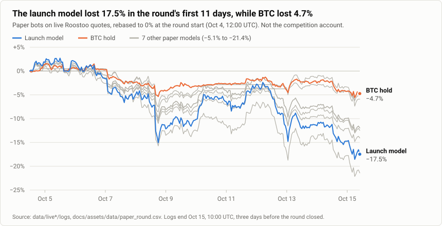
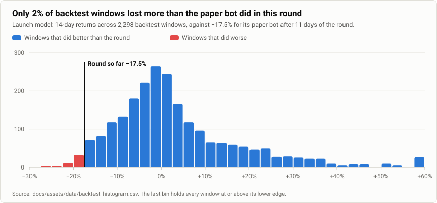
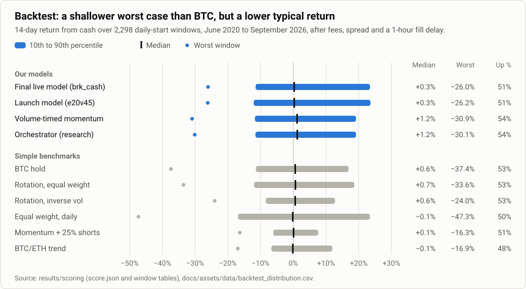
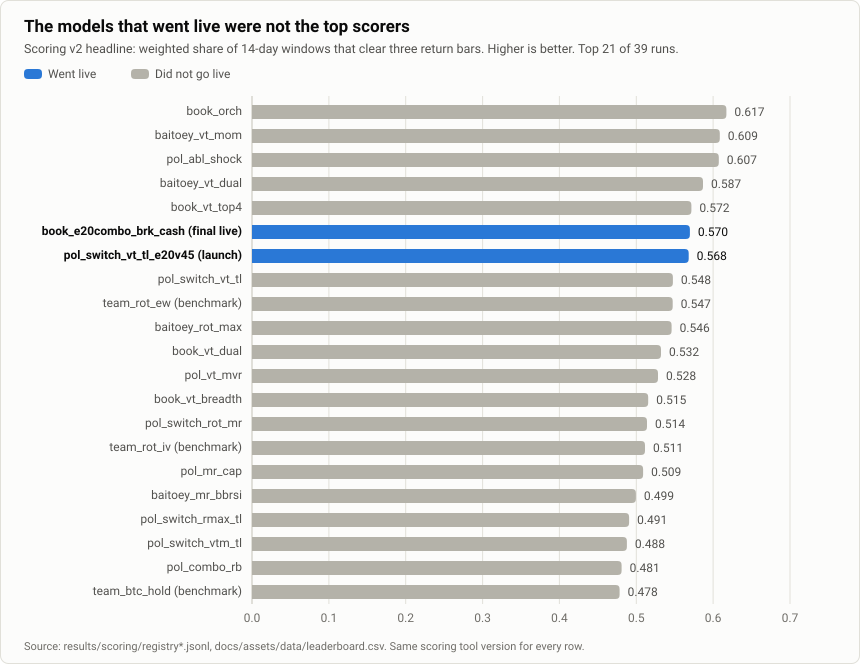
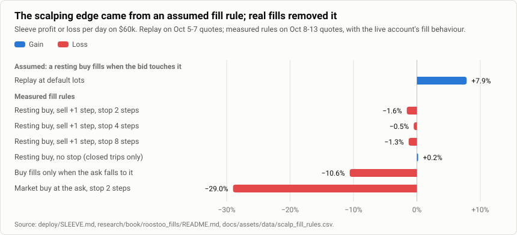
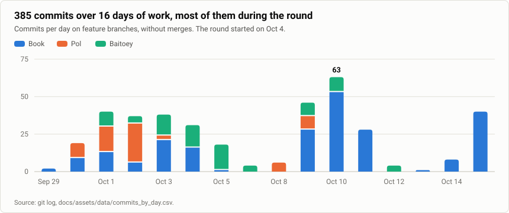

# Results

Every number here comes from the tables in [`assets/data/`](assets/data). [`scripts/report/build_data.py`](../scripts/report/build_data.py) built them from the server's results, and [`scripts/report/make_charts.py`](../scripts/report/make_charts.py) draws the charts from them.

Three kinds of evidence are kept apart, because they mean different things:

| Kind | What it is | Where |
|---|---|---|
| **Backtest** | Models replayed on 2020 to 2026 history, chosen with those results in view | [Backtest](#backtest) |
| **Paper, forward** | Bots on live Roostoo quotes during the round, with simulated fills | [The round on paper](#the-round-on-paper) |
| **Competition account** | The real mock account on EC2. Its logs were not on the research server | [The competition account](#the-competition-account) |

## The round on paper

The paper bots ran on the research server from Oct 1 or 2, on live Roostoo quotes. Returns are rebased to the round start (Oct 4, 12:00 UTC) and end at the last log (Oct 15, 10:00 UTC), 263 hours later. The bots were not reset to cash at the round start, so their opening positions differ from a real start.

<picture>
  <source media="(prefers-color-scheme: dark)" srcset="assets/charts/round_paper.dark.svg">
  
</picture>

| Paper bot | Model | Return | Max drawdown |
|---|---|---:|---:|
| BTC hold (reference) | `BTCUSDT` | −4.7% | 7.0% |
| Mean reversion, 4h | `baitoey_mr_4h` | −5.1% | 8.0% |
| Mean reversion, capped | `pol_mr_cap` | −5.9% | 8.6% |
| Momentum + shock rule | `pol_abl_shock` | −12.0% | 14.5% |
| Volume-timed momentum | `baitoey_vt_mom` | −12.0% | 14.5% |
| Rotation, equal weight | `team_rot_ew` | −12.5% | 14.6% |
| Volume/trend switch | `pol_switch_vt_tl` | −14.1% | 16.1% |
| **Launch model** | `pol_switch_vt_tl_e20v45` | **−17.5%** | **20.7%** |
| Rotation/trend switch | `pol_switch_rmax_tl` | −21.4% | 23.5% |

The final live model, `book_e20combo_brk_cash`, had no paper bot.

Against its own backtest, the launch model's result sits in the bad tail. 55 of 2,298 windows were worse, though those windows ran 14 days rather than 11:

<picture>
  <source media="(prefers-color-scheme: dark)" srcset="assets/charts/backtest_hist.dark.svg">
  
</picture>

## The competition account

The account's logs stayed on EC2, so only these figures from the team's notes exist here. They are not verified against the account.

| When | Figure | Source |
|---|---|---|
| Oct 10, 03:00 HKT | −11.6%, a replay of the launch model on live prices, not the account | Team notes |
| Oct 12, 06:00 UTC | −3.8%, team-reported | Team notes |
| Oct 15 | About −16%, team-reported | [final_recommendation.md](../research/book/gate/simulator_edge/final_recommendation.md) |
| Round end | **Not recorded in this repo** | |

They come from different sources and dates, so do not read them as one curve. The account also changed models on Oct 11.

## Backtest

14-day return from cash after fees, spread and exit costs, over 2,298 daily-start windows from June 2020 to September 2026. The means are unweighted. The headline score, below, is weighted.

<picture>
  <source media="(prefers-color-scheme: dark)" srcset="assets/charts/backtest_range.dark.svg">
  
</picture>

| Strategy | Mean | Median | 10th pct | 90th pct | Worst | Best | Above zero | Median max DD | Worst max DD |
|---|---:|---:|---:|---:|---:|---:|---:|---:|---:|
| **Final live model (`book_e20combo_brk_cash`)** | +3.7% | +0.3% | −11.5% | +23.5% | −26.0% | +98.6% | 51% | 9.7% | 30.8% |
| **Launch model (`pol_switch_vt_tl_e20v45`)** | +3.7% | +0.3% | −12.1% | +23.6% | −26.2% | +98.6% | 51% | 9.8% | 33.4% |
| Volume-timed momentum (`baitoey_vt_mom`) | +2.9% | +1.2% | −11.7% | +19.2% | −30.9% | +71.3% | 54% | 10.1% | 31.9% |
| Orchestrator, research (`book_orch`) | +2.9% | +1.2% | −11.6% | +19.2% | −30.1% | +68.4% | 54% | 9.8% | 31.0% |
| BTC hold (`team_btc_hold`) | +1.8% | +0.6% | −11.4% | +16.9% | −37.4% | +69.2% | 53% | 8.6% | 44.7% |
| Rotation, equal weight (`team_rot_ew`) | +2.3% | +0.7% | −12.0% | +18.7% | −33.6% | +76.8% | 53% | 10.4% | 38.3% |
| Rotation, inverse vol (`team_rot_iv`) | +1.7% | +0.6% | −8.4% | +12.8% | −24.0% | +41.3% | 53% | 7.0% | 27.9% |
| Equal weight, daily (`team_ew_daily`) | +2.3% | −0.1% | −16.9% | +23.4% | −47.3% | +133.7% | 50% | 13.8% | 58.8% |
| Momentum + 25% shorts (`team_mom_ss25`) | +0.6% | +0.1% | −6.1% | +7.6% | −16.3% | +25.3% | 51% | 4.8% | 16.6% |
| BTC/ETH trend (`team_trend_2`) | +1.5% | −0.1% | −6.7% | +11.9% | −16.9% | +45.6% | 48% | 5.2% | 18.6% |

Full table: [`backtest_distribution.csv`](assets/data/backtest_distribution.csv).

### By year

Windows are grouped by the year they start in. Each cell shows median / worst.

| Year | Windows | Final live model | Launch model | BTC hold |
|---|---:|---:|---:|---:|
| 2020 (from June) | 214 | +3.4% / −21.3% | +4.4% / −21.3% | +5.3% / −15.0% |
| 2021 | 365 | +3.4% / −21.0% | +3.4% / −21.5% | −0.0% / −37.4% |
| 2022 | 365 | −2.4% / −23.6% | −2.4% / −23.6% | −1.5% / −35.0% |
| 2023 | 365 | +0.8% / −17.3% | +0.8% / −18.3% | +1.5% / −17.4% |
| 2024 | 366 | +0.1% / −26.0% | −0.0% / −25.8% | +1.2% / −24.3% |
| 2025 | 365 | −3.6% / −20.2% | −3.6% / −26.2% | +0.2% / −18.7% |
| 2026 (to Sep) | 258 | +2.3% / −18.7% | +2.4% / −18.5% | −0.2% / −25.6% |

Its worst windows were much shallower than BTC's in 2021 and 2022. In 2024 and 2025 its typical fortnight was worse than BTC's. Data: [`backtest_by_year.csv`](assets/data/backtest_by_year.csv).

### Live-code replay

Before launch, the launch model ran hour by hour through the real runner and planner, on paper fills at Roostoo's pair rules, spreads and fees ([readiness report](../reports/review/20261002-e20v45-readiness.md)):

| Replay | Live code | Scoring engine | Errors |
|---|---:|---:|---:|
| Last season's Round 1, falling, 240 h | +3.63% | +3.42% | 0 |
| Last season's Final, rising, 240 h | +0.34% | +0.16% | 0 |

For comparison, `baitoey_vt_mom` made −4.31% on the Round 1 replay.

## Leaderboard

Scoring v2's headline is a weighted share of windows that clear three return bars ([EVALUATION.md](EVALUATION.md)). Every row uses scoring tool version `3036a0d8bfdaa6a0`.

<picture>
  <source media="(prefers-color-scheme: dark)" srcset="assets/charts/leaderboard.dark.svg">
  
</picture>

Data: [`leaderboard.csv`](assets/data/leaderboard.csv). The team's leaderboards are in [`reports/leaderboards/`](../reports/leaderboards).

## The scalping sleeve

Per-day profit or loss on a $60,000 sleeve. The replay's +15.6% over 46 hours is converted to a day. It covers Oct 5 to 7, while the measured rules cover Oct 8 to 13, so the two are not like for like.

<picture>
  <source media="(prefers-color-scheme: dark)" srcset="assets/charts/scalp_fill_rules.dark.svg">
  
</picture>

| Group | Variant | Per day |
|---|---|---:|
| Assumed fills | Replay at default lots | +7.9% |
| Measured | Resting buy, sell +1 step, stop 2 steps | −1.6% |
| Measured | Resting buy, sell +1 step, stop 4 steps | −0.5% |
| Measured | Resting buy, sell +1 step, stop 8 steps | −1.3% |
| Measured | Resting buy, no stop (closed trips only, mostly sits on unsold coins) | +0.2% |
| Measured | Buy fills only when the ask falls to it | −10.6% |
| Measured | Market buy at the ask, stop 2 steps | −29.0% |

Sources: [`deploy/SLEEVE.md`](../deploy/SLEEVE.md), [`research/book/roostoo_fills/README.md`](../research/book/roostoo_fills/README.md).

## Team activity

<picture>
  <source media="(prefers-color-scheme: dark)" srcset="assets/charts/activity.dark.svg">
  
</picture>

Data: [`commits_by_day.csv`](assets/data/commits_by_day.csv).
